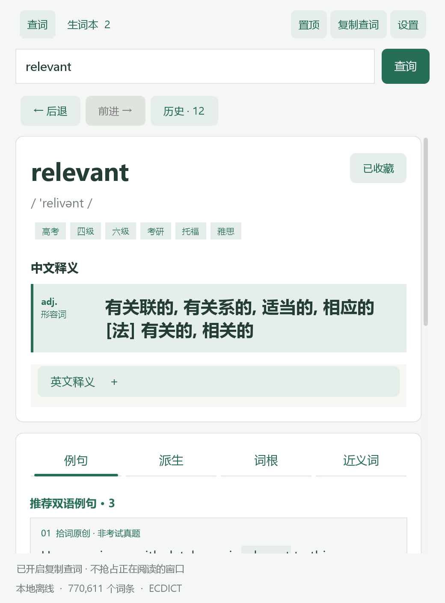
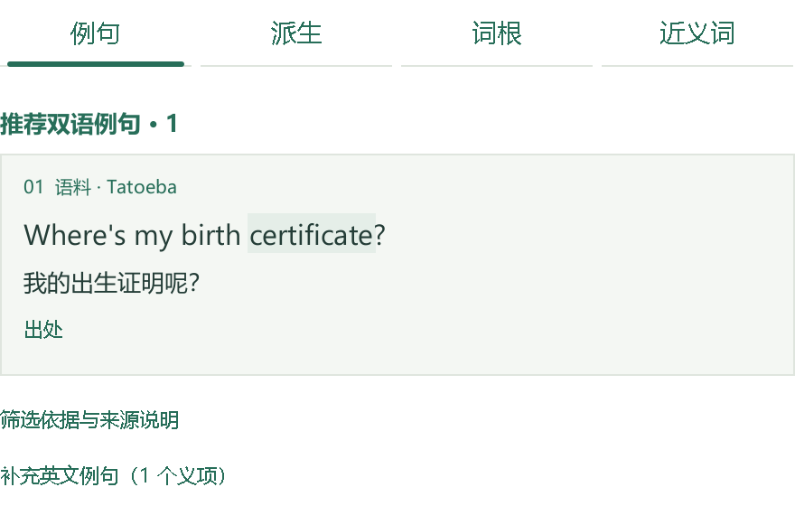

# 拾词 WordNest

面向 Windows 的离线英汉查词与生词本。阅读时复制单个英文单词，即可查看中文释义、音标和英文解释；还可切换“例句、派生、词根、近义词”四个学习分页，记录自己的例句并翻卡复习。

当前版本：**0.5.0**。使用 Java 17 / Swing，内置 ECDICT **770,611 条词条**。本版增加查词历史与前进后退、取消收藏后的笔记保留与恢复，并调整例句筛选和分组。日常使用不需要账号、API Key 或联网服务。

项目创建与维护：[zhangchuancheng](https://github.com/zhangchuancheng)。第三方词库、语料与界面库保留各自作者署名及许可，见 [第三方说明](THIRD_PARTY_NOTICES.md)。

[下载 Windows 便携版](https://github.com/zhangchuancheng/WordNest/releases/latest) · [查看版本记录](CHANGELOG.md) · [反馈问题](https://github.com/zhangchuancheng/WordNest/issues)





上图由 0.5.0 的实际 Swing 控件离屏绘制；导航数量为演示状态，例句来自随包资料。不含操作系统窗口标题栏或系统托盘菜单，也不是实际桌面的操作截图。

## 启动

### Windows 便携版

1. 到 [0.5.0 下载页](https://github.com/zhangchuancheng/WordNest/releases/tag/v0.5.0) 下载 `WordNest-0.5.0-Windows-x64.zip` 并完整解压。普通用户不需要下载源码压缩包。
2. 打开其中的 `WordNest` 文件夹，双击 `WordNest.exe`。
3. 等待离线资料加载完成，输入单词并按 Enter。

便携版内置 Windows x64 的 Eclipse Temurin Java 运行时，**无需另外安装 Java**。请保留整个文件夹，包括 `app`、`runtime`、文档和许可证；单独复制 EXE 无法运行。下载页同时提供源码 ZIP、SHA-256 校验和与单独的使用说明。

点击关闭按钮 × 时，默认询问“最小化到系统托盘”或“退出程序”，也可取消；勾选“记住我的选择”后会沿用该选择。顶部“设置”可以随时修改关闭与最小化方式，详见下文。

0.5.0 使用独立的便携目录与 ZIP，保留旧版本包。升级前先**完全退出旧版**：如果仍在托盘运行，右键拾词图标选择“退出拾词”。随后备份 `%LOCALAPPDATA%\WordNest`，再完整解压新包到新目录并启动新版。不同版本共用此目录中的个人数据，不要向旧程序文件夹零散覆盖文件。**0.5.0 首次写入旧版生词本时会升级文件格式，0.4.x 不能直接读取升级后的文件**；回退步骤见[本地数据与隐私](#本地数据与隐私)。

**旧版托盘菜单显示方框时**：双击托盘图标恢复主窗口，点击顶部“设置”，把“点击关闭按钮 × 时”改为“退出程序”，点击“保存”，再点击窗口 × 退出。旧实例未退出时，再次打开 EXE 只会唤回旧窗口，不会自动切换为新版。

### 源码版

准备 **JDK 17 或更新版本**，让 `JAVA_HOME` 指向 JDK，或将其 `bin` 目录加入 `PATH`，然后双击项目根目录的 `Launch.cmd`。没有 JAR 时脚本会先编译；已有 JAR 时直接运行，**修改源码或升级资源后请重新构建**：

```powershell
powershell -NoProfile -ExecutionPolicy Bypass -File .\scripts\build.ps1
powershell -NoProfile -ExecutionPolicy Bypass -File .\scripts\run.ps1
```

系统存在多个 Java 时，可分别传入 `build.ps1 -JdkPath 'C:\Path\To\JDK'` 与 `run.ps1 -JavaPath 'C:\Path\To\JDK'`。源码启动器使用 `javaw.exe`。

## 界面与阅读

### 0.5.0：查过的词可回看，取消收藏可恢复

查词页的“← 后退”“前进 →”沿本次打开程序后的查词路径移动，也可按 **Alt+← / Alt+→**。点击“历史”查看最近 100 个不同的成功查询词，选中后点“查看词条”重新打开；重查同一个词会移到列表最前。启动时显示上次词条不计为新查询，前进后退不改变最近列表顺序；回退后查询另一个词会结束原来的前进路径。未查到的词不会进入历史。

再次点击“已收藏”只取消收藏，**个人例句仍保留**。可立即点击窗口底部“撤销取消收藏”，也可到“生词本 → 最近取消收藏”，选中词条后点“恢复收藏”或“查看词条”。继续编辑这些保留的笔记不会自动重新收藏；需要恢复时点“收藏”或“恢复收藏”。取消收藏的条目不计入生词本、翻卡复习和 CSV 导出。

### 0.5.0：例句按可核对的规则排序

例句页默认展示最多 3 组“推荐双语例句”：优先实际包含查询词或来源明确记录词形的短句，并依据长度、句末标点、是否省略或分段筛选。在都符合筛选条件且词形匹配程度相同时，已有学习卡优先，其次原创练习、社区语料，同类再优先较短的句子。具体条件可展开“筛选依据与来源说明”查看。若没有满足条件的短句，会在“双语语料参考”中保留一条；其余内容放入“更多语料”，不会从原资料中删除。

英文归一后重复的例句合并展示；不同的原句、原译文、作者、编号、许可和链接仍可在“出处”或“出处与原译文”中查看。排序与去重只整理展示，**不代表人工审校，也不保证语法、自然度或译文准确性**。

WordNet 英文例句按原资料的真实义项分组，保留英文释义和义项编号；没有配套中文译文，不自动补译。社区双语句没有对应的词典义项标注，不会靠猜测归入这些义项。未出现查询拼写的 WordNet 句子仍放在“补充英文例句”，可能使用词形变化或同义词。

常用搭配、原始词源记录和参考来源按需展开；四个分页和各分组的展开状态互相独立，切换词条后恢复默认。派生与近义词支持点击查询，卡片随实际可用宽度换行。本版沿用 0.4.3 的托盘中文字体修复，没有扩充词库或加入自动翻译。

### 延续 0.4.1 的释义与配色

0.4.1 压缩顶部品牌区，采用浅绿白底与绿色工具栏。中文释义按词性分行，以浅绿色强调第一条、深绿色标示词性；保留词库义项顺序和原文，不推断最常见词义。形容词统一显示 adj.，副词统一显示 adv.（仅规范显示缩写，不修改源词库）。长单词、中文释义与考试标签会随可用宽度换行。

英文释义默认收起，点“英文释义 ＋”查看完整原文，再点可收起；每次切换词条重新默认收起。学习分页仍独立显示，个人例句在下方编辑区自动保存。

应用标题栏改为与正文协调的浅绿白背景、深绿色标题；活跃和非活跃均使用相近颜色，不更改 Windows 系统主题。窗口装饰采用随包携带的 FlatLaf 3.7.2，源码包的 `lib` 目录也需保留。

## 查词与学习

| 操作 | 说明 |
| --- | --- |
| 手动查词 | 输入单词或主词库收录的简短词组，按 Enter 或点击查询；不区分英文大小写。 |
| 复制查词 | 开启顶部“复制查词”，在其他软件中复制单个英文单词。窗口更新词条，设计上不主动抢焦点。 |
| 窗口置顶 | 使用顶部“置顶”按钮，方便边阅读边查看。 |
| 例句分页 | 优先显示最多 3 组符合短句条件的双语例句，其余在“更多语料”。重复英文合并展示，原句、原译文与来源仍在出处中；WordNet 按真实义项分组。 |
| 派生分页 | 查看常见派生词和词典明确记录的派生关系，点击主词库已收录的相关词继续查词。 |
| 词根分页 | 先读中文学习提示；“词源原始记录”默认收起，可展开核对历史词源与构词关系。 |
| 近义词分页 | 按具体词义查看同义词组；355 个词头另有中文用法区别。 |
| 来源与补充内容 | “出处”“参考来源”“开放资料出处”和各内容分组可独立展开；地址可以选中复制，不会自动打开浏览器。 |
| 收藏与恢复 | 点击“收藏”加入生词本；点击“已收藏”取消收藏并保留笔记。底部“撤销取消收藏”恢复刚取消的一项，“生词本 → 最近取消收藏”可恢复其他保留条目。 |
| 我的例句 | 停止输入约 750 毫秒后保存；第一次填写非空内容会自动收藏。已取消收藏的条目继续编辑只保存笔记，不重新收藏。切换学习分页保留编辑内容。 |
| 生词本 | 搜索当前收藏的单词、中文释义或个人例句；双击条目、选中后按 Enter 或点“查看词条”打开。 |
| 查词历史 | 点“历史”查看最近 100 个不同的成功查询词；“清空历史”经确认后清除最近列表和本次前进后退路径，保留当前词条、收藏和个人例句。 |
| 后退 / 前进 | 点击“← 后退”“前进 →”，或在应用窗口内按 Alt+← / Alt+→；仅沿本次会话移动，不把回看重复计入最近查询。 |
| 翻卡复习 | 随机排列收藏，先看单词和个人例句，再显示释义；“下一张”循环浏览。未实现间隔复习算法。 |
| 导出 CSV | 导出全部收藏，包含单词、音标、中英释义、个人例句与收藏时间；UTF-8 编码。 |
| Ctrl+L | 在应用窗口内聚焦搜索框，Enter 执行查询。 |

复制查词去除首尾空白后，只接受英文字母组成的 `[A-Za-z]+` 单词，原剪贴板文本最多 80 个字符。中文、整句、图片、数字、连字符和撇号不会替换当前词条；未收录的单词也会保留当前结果并提示。启动或重新启用复制查词时，不立即查询剪贴板里的旧内容，检测间隔约 650 毫秒。

个人例句最多 20,000 字符。切词或退出前也会尝试保存；若提示失败，请先保留编辑内容并检查数据目录。复习或文件选择等对话框显示期间，自动查词会暂停影响当前操作。

历史文件读取失败时保留原文件，并提示本次查询历史只存在内存中；基础查词和生词本仍可使用。运行中历史保存失败也不会阻断查词，仍可沿本次会话前进后退；未保存的查询不会写进磁盘上的最近列表。若个人例句保存失败，则先保留当前编辑内容，不切换词条。

## 窗口、托盘与退出

- **关闭 × / Alt+F4**：默认每次询问，可选“最小化到系统托盘”“退出程序”或“取消”。勾选“记住我的选择”后，下次按保存的方式处理。
- **最小化 −**：默认最小化到任务栏。顶部“设置”中的“窗口与后台设置”可分别修改关闭与最小化方式，关闭方式也可改回“每次询问”。
- **托盘后台运行**：窗口隐藏后，复制查词仍按开关状态工作，查到单词不会主动弹出窗口。托盘图标可能收在 Windows 任务栏右下角的小箭头中。
- **恢复窗口**：双击托盘图标，或右键选择“显示拾词”；再次运行同一数据目录下的 `WordNest.exe` 也会请求唤回已运行的窗口。
- **托盘菜单**：可开关“复制查词”、打开“窗口与后台设置…”或选择“退出拾词”。**右键 → 退出拾词**会完全退出，不受记住的关闭方式影响。

无法进入托盘时，应用会保留或恢复窗口并提示。笔记或设置保存失败时也不会直接退出，请先处理提示中的保存问题。退出后再进行数据备份或更换版本；仅把窗口藏到托盘不等于退出。

## 资料覆盖与阅读边界

**770,611 是主词库条目数，不是每个学习分页的覆盖数。** 下列数字分别来自独立数据集，覆盖相互重叠，不能相加当作词汇总量。

| 资料 | 本包实际覆盖 | 内容与限制 |
| --- | ---: | --- |
| ECDICT 主词库 | 770,611 条 | 中文释义 768,739 条；音标 218,065 条；英文释义 160,884 条。 |
| Open English WordNet 2025 | 127,311 个不区分大小写的词头 | 185,129 条义项记录；其中 35,702 个词头有例句、91,058 个有同义词、27,254 个有派生关系。 |
| Wiktionary / etymology-db 2023-12 | 134,158 个词头 | 筛选得到 309,779 条词源与构词关系。 |
| 中文学习卡 | 355 个词头 | 至少 710 条原创中英例句；每词均有搭配、派生或同词族说明、中文近义辨析、构词或词源提示。 |

学习资料沿用 0.4.0 的扩充结果：面向 7,684 个优先词（含 4,948 个 ECDICT ielts 标签词），当时给 **6,695 个词新增资料**。合并原有内容后，6,260 词有中文例句、5,416 词有词族或词典派生关系、6,887 词有词源记录、6,510 词有近义关系，**4,078 词四栏同时有资料**。其中 2,234 词有中文词源或词缀释义，其余词源可能只有原文记录。原有 355 张完整中文卡片保留；0.5.0 重新排序和分组现有例句，没有扩充词库。

随包 14,937 条 Tatoeba 例句展示记录来自 11,269 组不同英汉句对；另有 341 条补充原创学习例句。来源包括 [Tatoeba 官方导出](https://downloads.tatoeba.org/exports/) 与 [Kaikki 中文维基词典数据](https://kaikki.org/zhwiktionary/)，每条保留署名与出处。这些词并非全部具有“完整中文精编卡”。

**仍有缺项。** 优先词表中 1,424 个词暂无中文例句；派生、近义和词根也非每词都能补齐。不用相似拼写猜关系，不把通用空话当词根解释。原始来源的译文、词义和提取结果可能有疏漏；已做标签过滤与内容抽查，未声称逐条专业审定。全部口径与逐词表见 [LEARNING_COVERAGE.md](LEARNING_COVERAGE.md)。

organize / organise、recognize / recognise、behavior / behaviour、labor / labour 共用对应中文学习卡；四个别名不重复计入 355 个词头。原创例句和中文辨析为学习整理，不冒充权威词典原文或真题。源数据里的关系与编写的解释都可能有疏漏，结构检查不能代替专业词典编辑的语义审定。

阅读学习分页时请留意：

- **WordNet 原例句没有配套中文译文。** 它们说明某个共同义项，可能使用同义词组中的另一个词，而非当前词头；逐条例句保留原资料已有的作者或来源说明。
- 同义词按英文义项分组，不保证在所有句子里互换。词旁中文来自 ECDICT，可能含其他义项，应以所在组的英文释义为准。
- WordNet 派生关系可能连接到词基或派生词，不预设单一方向；复数、过去式等词形变化不等于派生新词。
- 词源库是 **2023-12 快照**，包含自动提取关系，并未逐条人工核验。同形异源词可能有多条来源；来源链中的成分不一定是当前词的直接词根，组内序号也不等于已确定的历史路径。当前 Wiktionary 页面可能已修订。
- relevant 的 re- / lev / -ant 标为历史形式的助记拆分，不当作现代英语可任意拼接的构词规则；同源词不自动等于近义词。
- 缺少释义、音标、例句或关系时明确显示缺项，不根据拼写猜词根，不自动补写词典例句。部分页面先显示有限条目，可按“展开其余”继续查看。

ECDICT 固定于提交 `bc015ed2e24a7abef49fc6dbbb7fe32c1dadaf8b`；Open English WordNet 固定为 2025 edition；etymology-db 固定为 2023-12 发行数据。上游、处理规则、校验值和许可见 [第三方说明](THIRD_PARTY_NOTICES.md) 与 licenses 目录。

当前版本没有联网查询、发音播放、OCR、整句翻译、运行时 AI 生成、云同步、CSV 导入、间隔复习算法或完整备份管理界面。音标沿用主词库，不额外区分英美发音。主词库含词组、变形词和专业词，条目数不等于互不重复的基础词汇数。

新增社区例句保留简繁体；用来源记载的正常词形进行匹配时显示“例句词形”。中文维基词典派生项可能含复合词和词组，近义项保留原词性和义项范围。单个词缀的一般释义不能代替该词的完整历史词源。

## 本地数据与隐私

```text
%LOCALAPPDATA%\WordNest
├─ favorites.tsv        当前收藏、已取消收藏的条目及个人例句（v2）
├─ favorites.tsv.v1-backup  旧版生词本首次升级前的原样备份（迁移时生成）
├─ history.tsv          最近 100 个不同的成功查询词
├─ settings.properties  复制查词、置顶、上次词条、关闭与最小化设置
├─ app.lock             防止同一数据目录被多个实例同时修改
└─ activation.*         运行期间使用的本地窗口唤回文件
```

在资源管理器地址栏输入 `%LOCALAPPDATA%\WordNest` 可打开目录。备份时先完全退出应用；托盘中运行的版本请右键图标选择“退出拾词”，然后复制整个目录。`favorites.tsv` 和 `history.tsv` 是应用内部格式，其文本字段使用 Base64 编码；要用 Excel 查看当前收藏请使用 CSV 导出。CSV 不包含已取消收藏条目，也不能导回应用，因此不能代替完整数据目录备份。数据没有加密，同一 Windows 用户可访问这些文件。

**从 0.4.x 升级：** 新版可读取 v1 生词本。首次保存笔记、收藏或取消收藏前，会先保留原文件为 `favorites.tsv.v1-backup`，然后写入支持保留未收藏笔记的 v2 格式；仅打开软件不会立即迁移。若同名备份已存在且内容不同，会使用带唯一后缀的新文件，已有备份不会被覆盖。备份失败时不会升级或替换原生词本。这是迁移前保护，不是持续自动备份。

**需要回退到 0.4.x 时：** 先完全退出 0.5.0，再另外复制整个当前数据目录留存新内容。随后将升级前自行备份的 `favorites.tsv`，或这次迁移生成的 `favorites.tsv.v1-backup`（必要时核对唯一后缀），复制回数据目录并命名为 `favorites.tsv`，再启动旧版。**0.4.x 不能直接读取 v2 文件；迁移前备份不含升级后新增的收藏、笔记和状态修改**，请勿把回退当作无损合并。

更换程序目录不会自动删除个人数据。查询历史与收藏分别保存；清空历史不删除收藏、保留的个人例句或迁移备份。应用不保存完整剪贴板历史，也不上传查询或收藏内容。

## 从源码构建

无需 Maven 或 Gradle。界面依赖 FlatLaf 3.7.2，固定版本的 JAR 与 Windows x64 DLL 已放在 `lib/`，构建前自动校验 SHA-256，无需另行下载。脚本使用 `javac --release 17 -encoding UTF-8`，将类与资源打包到 `build/input/wordnest.jar`，并通过 JAR manifest 引用同级 `lib/` 中的依赖。

```powershell
# 生成 Java 17+ 可运行的 JAR
.\scripts\build.ps1 -JdkPath 'C:\Path\To\Your\JDK'

# 生成 0.5.0 独立便携目录；不会安装到系统
.\scripts\build.ps1 `
  -JdkPath 'C:\Path\To\Your\JDK' `
  -RuntimePath 'C:\Path\To\Temurin-JRE-17' `
  -BuildVariant v050 `
  -PackageOutputPath 'C:\Path\To\WordNest-Windows-0.5.0'
```

第二条命令使用 `jpackage --type app-image`，输出 `WordNest/WordNest.exe`。`-RuntimePath` 指向包含 `bin/java.exe` 的合法可分发运行时。本次运行时为 Eclipse Temurin 17.0.20.1+1；开发机上的 Oracle JDK 只负责构建，不随包分发。

脚本仅清理带有本项目标记的构建子目录。如果目标已有 WordNest 文件夹，会改用带时间戳的新目录保留旧包。`-BuildVariant v050` 将构建结果放入 `build/v050/classes` 和 `build/v050/input`；源码启动脚本仍使用默认的 `build/input/wordnest.jar`。完成便携目录后，可将整个目录及许可证一并压成 ZIP，不能只打包 EXE。

### 重新生成数据

新增资料可离线复现：

```powershell
python scripts/prepare_open_learning.py --check
python scripts/assemble_curated.py --check
```

`prepare_open_learning.py` 使用随源码提供的选编来源快照，重新生成 WNS1 索引、逐词覆盖清单与统计。去掉 `--check` 会写回生成文件；完整源数据重新导入方法见 `licenses/Open-learning-NOTICE.md`。原有 355 张卡的独立清单现在是 `CURATED_COVERAGE.md`，整体覆盖清单是 `LEARNING_COVERAGE.md`。


中文卡片的编辑源在 data/learning。运行 python scripts/assemble_curated.py 合并分片并生成应用资源、覆盖清单与来源计数；附加 --check 只验证现有生成结果，不写文件。脚本检查五列格式、中文字段、每词四栏覆盖、词表遗漏、重复例句和来源地址对应关系；这些检查不能自动证明英文用法或历史词源正确。新增词的频率和考试标签保存在 priority-evidence.json，方便后续按词表继续扩充。

日常构建直接使用随源码提供的资源，无需下载。只有重新转换数据时需要 Python 3 和相应源文件：

```powershell
python .\scripts\prepare_dictionary.py --download-dir .\build\dictionary-source
python .\scripts\prepare_learning_data.py --download-dir .\build\learning-source
python .\scripts\prepare_etymology.py --source 'C:\Path\To\etymology-2023-12.csv.gz'
```

前两个脚本按固定来源下载并核对数据；词源脚本只读取指定的本地文件，不自动下载。词源原文件地址和 SHA-256 见 `licenses/Etymology-data-NOTICE.md`。转换会写入资源目录与相关溯源说明，修改后需要重新构建。词源二进制压缩为 2,721,192 字节，展开为 20,111,260 字节；这不是整个应用的内存占用。

## 验证记录

本版真实验证结果见 [VALIDATION.md](VALIDATION.md)。0.5.0 的验证范围为数据模型、迁移与失败保护的无窗口测试、Swing 控件离屏检查以及原生 EXE 自检；具体完成项和统计以该文件为准。**未操作实际桌面，未进行真实窗口、托盘、焦点、快捷键或系统 DPI 交互验收**；离屏预览不能代替这些屏幕验收。

0.4.2 的历史验证包括 Java 17 无窗口逻辑与数据检查、真实 Swing JPanel 离屏布局及原生 EXE 自检。窗口与托盘功能当时使用无窗口 host 和临时文件验证逻辑，未进行真实桌面的关闭、最小化、唤回、焦点或系统 DPI 交互验收，也未读取真实剪贴板。以下 0.2.0 与 0.1.0 段落同样保留为历史记录。

### 0.2.0：历史无窗口验证

本轮使用实际 **Temurin 17**、`-Djava.awt.headless=true -Xmx512m` 完成：

| 测试 | 真实结果与范围 |
| --- | --- |
| LearningRepositoryTest | **499 项断言通过**；覆盖索引查询、义项分组、来源保留、乱序输入、二进制及 gzip 损坏、TSV 格式、资源大小限制、流关闭行为，以及实际随包资源。 |
| LearningPanelTest | **172 项纯 JPanel 界面断言通过**；覆盖四个分页、相关词跳转回调、来源展开、缺项提示，以及 relevant 在 340 / 440 像素内容宽度下的末行文字边界。 |
| 词源资源读回 | 全量解码 309,779 条关系，核对 134,158 个词头、UTF-8、长度、词序及无尾部残留。 |

新增 IndexedLearningData 按词头建立索引，LearningRepository 按需解码。分页测试只构造 JPanel 并绘制离屏图片，**不创建任何 Window，不访问剪贴板，不注入鼠标键盘输入**。测试调用按钮处理器，不执行桌面点击。已查看生成的例句和词根离屏预览，在所测尺寸下未发现裁切。

0.2.0 **未再次执行桌面交互、跨程序复制、焦点或人工重启验收**。本轮预览存于工作目录，下面的复现命令输出到 build/learning-preview；预览不放进运行资源目录，不能证明真实桌面上的全部布局或交互效果。

在项目根目录复现无窗口测试：

```powershell
$jdk = 'C:\Path\To\Your\JDK'
$java = 'C:\Path\To\Temurin-JRE-17\bin\java.exe'
New-Item -ItemType Directory -Force .\build\test-classes | Out-Null
$sources = @(Get-ChildItem -LiteralPath .\src\main\java\wordnest -Filter '*.java' | ForEach-Object FullName)
& "$jdk\bin\javac.exe" --release 17 -encoding UTF-8 `
  -cp '.\lib\flatlaf-3.7.2.jar' `
  -d .\build\test-classes @sources `
  .\tests\LearningRepositoryTest.java .\tests\LearningPanelTest.java
& $java '-Djava.awt.headless=true' -Xmx512m `
  -cp '.\build\test-classes;.\src\main\resources;.\lib\flatlaf-3.7.2.jar' `
  wordnest.LearningRepositoryTest --full
& $java '-Djava.awt.headless=true' -Xmx512m `
  -cp '.\build\test-classes;.\src\main\resources;.\lib\flatlaf-3.7.2.jar' `
  wordnest.LearningPanelTest .\build\learning-preview
```

### 0.2.0 便携 EXE 历史自检

本次已使用实际 **0.2.0 WordNest.exe** 完成无窗口自检：退出码 `0`、`status=PASS`、`headless=true`，`java.home` 指向包内 runtime，Java 版本为 `17.0.20.1`。报告确认主词库 770,611 条、词汇学习资料 127,311 个词头、词源资料 134,158 个词头、原创学习卡 12 个词头。构建工作记录为 `work/wordnest-0.2.0-native-check.properties`。

`--self-check` 检查启动器、包内 Java、主词库、图标和三份学习资源，并核对 algorithm / relevant 样例。这是原生启动器与资源检查，不表示人工 GUI 验收；下列命令可复现。

在 WordNest.exe 所在目录打开 PowerShell，指定**尚不存在**的报告文件完整路径：

```powershell
$check = Start-Process -Wait -PassThru -WindowStyle Hidden `
  -FilePath .\WordNest.exe `
  -ArgumentList @('--self-check', '"C:\Path\To\new-report.properties"')
$check.ExitCode
Get-Content -LiteralPath 'C:\Path\To\new-report.properties' -Encoding UTF8
```

该分支在单实例检查、用户数据目录和界面初始化之前执行，强制 `java.awt.headless=true`；不创建窗口，不读取剪贴板或真实生词本。成功时退出码为 0，报告应包含：

```properties
status=PASS
app.version=0.2.0
headless=true
dictionary.entries=770611
learning.lexical.words=127311
learning.origin.words=134158
learning.curated.words=12
```

java.home 应指向包内 runtime。报告以新建方式写入，不覆盖已有文件；参数或报告写入失败返回 2，资源检查失败返回 1。

### 0.1.0 阶段的历史验证

以下是 **0.1.0 阶段已完成的记录，未在 0.2.0 重跑桌面测试**：

| 检查 | 当时的真实结果 |
| --- | --- |
| CoreTest | Temurin 17 下 **1,048 项核心断言通过**；覆盖词库查询、大小写、前缀建议、乱序与坏数据、收藏增删、重启读回、中文多行例句及写入失败保护。 |
| MainWindowStateTest | **34 项隐藏窗口状态断言通过**；测试会创建隐藏窗口，覆盖切词保存、编辑保护、失败重试与复制输入过滤。 |
| DefinitionLayoutTest | **40 项布局检查通过**；检查五个真实词条在 440 / 480 / 640 像素宽度及直接缩窄后的中英释义末尾位置。 |
| 可见界面检查 | 手动查 algorithm；收藏、例句、生词本和翻卡；记事本复制 preserve 后更新且不抢焦点；复制中文段落保持当前词。 |
| 当时的便携 EXE | 自检退出码 0、PASS，使用包内 Temurin 17.0.20.1 并读入 770,611 条词条；该记录只适用于当时的包。 |

ECDICT 转换时对全部 770,611 条记录进行了读回比对。旧隐藏窗口与布局测试保留在 tests 目录，不属于本轮纯 headless 测试命令。历史人工检查未继续覆盖关闭后重新打开程序；收藏重启读回由核心测试验证。

## 项目结构与许可

```text
src/main/java/wordnest/
  App.java                   启动、单实例与数据目录
  PackageCheck.java          EXE 无窗口资源自检
  MainWindow.java            查词、生词本、复习与导出
  BackgroundController.java  关闭、最小化、托盘与退出策略
  TraySupport.java           系统托盘图标和菜单
  ActivationRequests.java    二次启动时的本地窗口唤回协议
  WordDetailPanel.java       中文词性分行与英文释义折叠
  LookupToolbar.java         紧凑查词工具栏
  LookupNavigationBar.java   查词历史与前进后退按钮
  LookupHistory.java         本机最近查询与独立会话导航
  LookupSession.java         切词前笔记保存与历史位置协调
  Theme.java                 绿色界面与统一标题栏
  LearningPanel.java         四个学习分页与来源展示
  ExampleSelection.java      例句筛选、排序与保留来源的合并展示
  LearningRepository.java    学习资料查询和义项结构
  IndexedLearningData.java   数据验证、词头索引与按需解码
  DictionaryRepository.java  ECDICT 读取和查询
  FavoritesStore.java        收藏、取消收藏笔记与 v1 迁移保护
src/main/resources/
  dictionary.bin.gz          ECDICT 主词库
  lexical.bin.gz             Open English WordNet 学习资料
  etymology.bin.gz            独立 CC BY-SA 3.0 词源数据
  etymology.metadata.json.gz  词源转换记录
  learning-curated.tsv        355 个词头的中文学习卡及来源行
  curated-words.txt           随包覆盖清单，用于全部学习卡自检
  learning-open.bin.gz       常用与雅思标签词补充资料
  expanded-coverage.tsv      7,684 个优先词的实际覆盖清单
  app.ico                    自绘书本图标
data/learning/               原始分片、选词表和频率/考试标签依据
lib/                        固定版本 FlatLaf 及 Windows x64 DLL
docs/                       实际控件布局预览
scripts/                     构建、启动与数据转换
tests/                       自动检查与离屏渲染测试
licenses/                    上游许可全文、署名与溯源
```

各资料分别授权：ECDICT 为 MIT；Open English WordNet 为 CC BY 4.0，并保留底层 Princeton WordNet 许可和署名；独立词源数据为 CC BY-SA 3.0。**词源数据的相同方式共享许可不用于替代应用源码或其他独立数据集的许可。** 运行时依照其随附许可证分发。详细归属与修改说明见 [THIRD_PARTY_NOTICES.md](THIRD_PARTY_NOTICES.md)。
